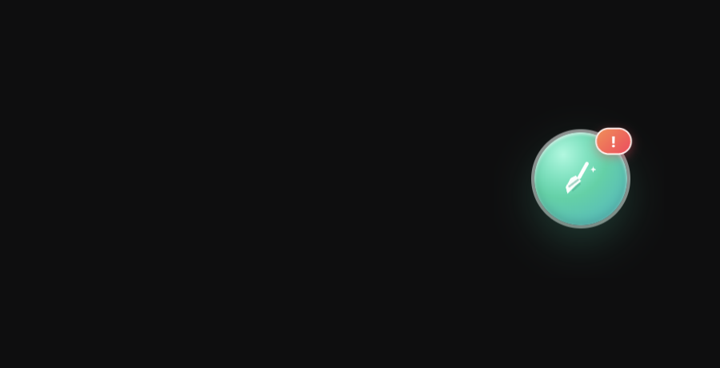

# 上下文清理大师 · Context Cleanup Master

**给 DeepSeek Harness（DSH）加一颗「一键清理」悬浮球：深度扫描近期会话的真实 token 消耗，播完管家式清理动画，然后——开一个全新会话。**

[](LICENSE)
[](#兼容性)
[](#兼容性)

> **English**: A prank "one-click cleanup" floating ball for DeepSeek Harness. It scans recent
> sessions' **real** token usage from the session catalog, plays a full old-school cleaner
> animation (radar scan → context-health score report → cleaning progress → 100 score), and then
> starts a brand-new session. It never calls a model, never writes session data — the only real
> side effect is the new empty session.

---

## 它到底做了什么

| 环节 | 真的 | 演的 |
| --- | --- | --- |
| 扫描 | 从宿主会话列表读取近期会话的 `tokenUsage` 投影，真实 token 数、会话数 | 「无效上下文碎片」「重复会话缓存」等扫描项 |
| 报告 | 上下文健康度评分（由真实 token 总量推导，越重分越低）、消耗最多的近期会话 Top3 | 「可清理垃圾 XX.X GB」「已有 1,284,392 位用户使用」 |
| 清理 | 进度环、已释放计数 | 整个清理过程本身（不删除任何东西） |
| 结束 | **调用 `uiWorkspace.startSession()` 开一个全新空白会话** | 「已释放 XX.X GB」「本次清理未产生任何副作用」 |

唯一的真实副作用是**新建会话**。不调模型、不写会话日志、不改任何已有会话或工作区文件；不注册 Tool、不发布 Service，对模型完全不可见。

## 长什么样

悬浮球常驻界面，可拖动并记忆位置：



点开后先「深度扫描」：


扫描完成给出上下文健康度、真实 token 与会话清单（两段式：先看报告，再决定清理）：


点「一键清理」播放清理动画：


100 分完成页，然后自动开启全新会话：


## 安装

### 从 npm 安装（推荐）

```bash
dsh plugin --profile <profile> add dsh-plugin-context-cleanup-master
```

或在 DSH Desktop 的插件管理页搜索包名安装。包页：https://www.npmjs.com/package/dsh-plugin-context-cleanup-master

### 从 GitHub 安装（锁定 main 分支源码）

```bash
dsh plugin --profile <profile> add github:JJJACKsong/dsh-plugin-context-cleanup-master
```

### 本地目录安装

```bash
git clone https://github.com/JJJACKsong/dsh-plugin-context-cleanup-master.git
dsh plugin --profile <profile> add ./dsh-plugin-context-cleanup-master
```

或者让 Agent 用 `plugin_manager` 的 `install_bundle`，target 传目录绝对路径。安装后如果页面没有热更新，刷新一次 Web UI。

卸载：

```bash
dsh plugin --profile <profile> remove dsh-plugin-context-cleanup-master
```

## 使用

- 悬浮球默认在右下角；按住拖动可换位置，位置保存在 `localStorage`（`ccm.ball.position.v1`）；
- 点击球 → 从球边弹出管家卡片并自动扫描（约 2 秒）；
- 报告页点「一键清理」→ 约 1.9 秒清理动画 → 100 分完成页 → 自动打开一个全新空白会话；
- 「暂不清理」/ 右上角 × / `ESC` 可随时退出，不会开新会话；
- 球上的红点角标只是装饰。

## 边界与隐私

- 只读会话列表快照（标题 + `tokenUsage` 投影），**不打开、不保留（retain）任何会话历史**；
- 不发起任何模型请求，不写会话日志、不写工作区文件；
- 所有「垃圾体积 / 释放空间」都是演出数字，不会执行任何删除操作；
- 文案中英双语走宿主 locale 服务，界面配色是插件自己的管家风，不复用宿主主题色。

## 技术笔记

- **纯浏览器半插件**：Host 半是空壳 `apply()`，界面通过 `ctx.slots.inject('shell.overlay', …)` 注册在帧级悬浮层，跟随页面常驻、切会话不消失；
- **真实统计来源**：客户端 `sessions.list` 快照里每个会话行本来就带 summary 投影，`tokenUsage`（未缓存输入 / 输出 / 缓存读 / 缓存写）是其中之一，所以「扫描」不需要打开任何会话；
- **开新会话**：与侧栏「新建会话」同一入口 `uiWorkspace.startSession()`，不发送消息、不修改已有会话；
- **两个 DSH 主题适配坑**（供写 UI 插件的同学参考）：
  1. 宿主 `corner-shape.css` 用 `corner-shape: superellipse(1.5)` 作用于所有元素，`border-radius: 50%` 会被渲染成 squircle。所有圆形 / 胶囊元素需要显式写 `corner-shape: round`；
  2. 宿主会给任何 `role="dialog"` / `aria-modal="true"` 的元素套上深色模态皮肤（`--dsw-appearance-modal-l2-*`）。自绘卡片用 `role="region"` 可以避开。

## 开发

```bash
node --check client.js      # 语法检查
npm test                    # 单项测试（纯函数 + 注册 + 各阶段渲染冒烟）
```

目录：

```
client.js          浏览器半（UI、动画、统计、开新会话）
index.js           Host 半（空壳 apply）
cordis.patch.yml   bundle 行声明
locale/            Plugin Manager 元数据（中/英）
icon.svg           插件图标
docs/screenshots/  README 截图
test/              单元测试
```

## 兼容性

- DSH Web UI（`dsh web` / DSH Desktop），`engines.dsh >= 0.2.0`；
- 依赖宿主 Client 服务：`slots`、`locale`、`sessions.list`、`uiWorkspace`（缺失时插件不会弹出面板）；
- 主题适配逻辑写在插件自己的样式里，不读取宿主 DOM 结构。

## License

[MIT](LICENSE) © 2026 JJJACKsong

> 本项目是一个整蛊插件：「清理」是假的，唯一真实动作是开一个新会话。请勿用于任何需要真实数据清理的场景。
